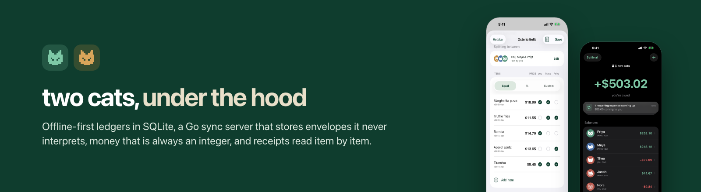
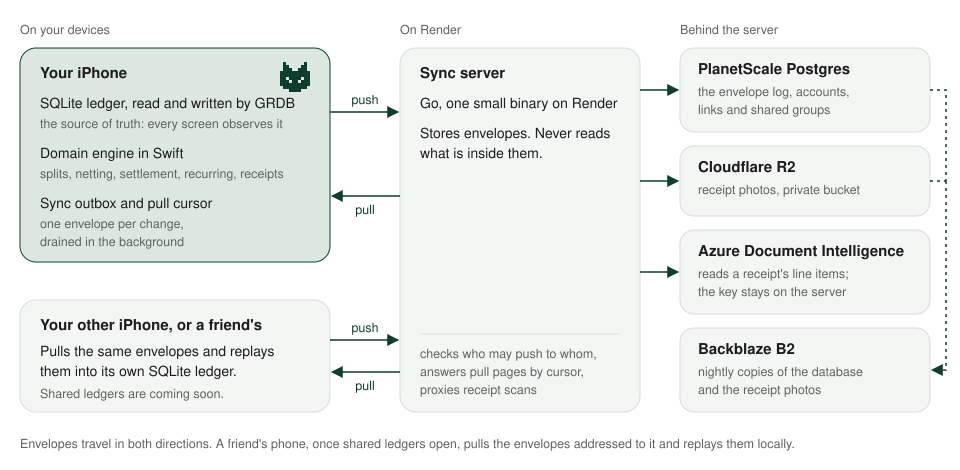
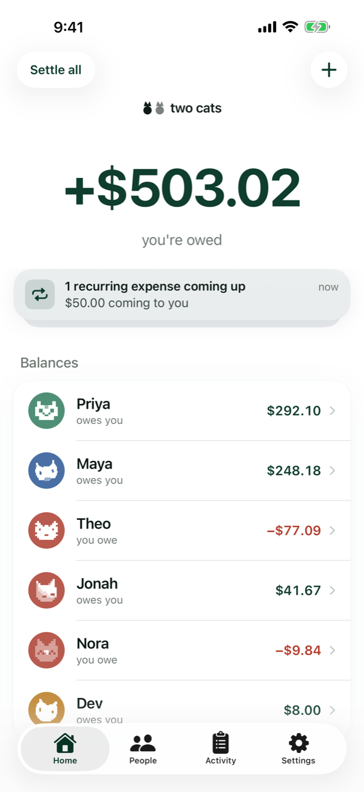
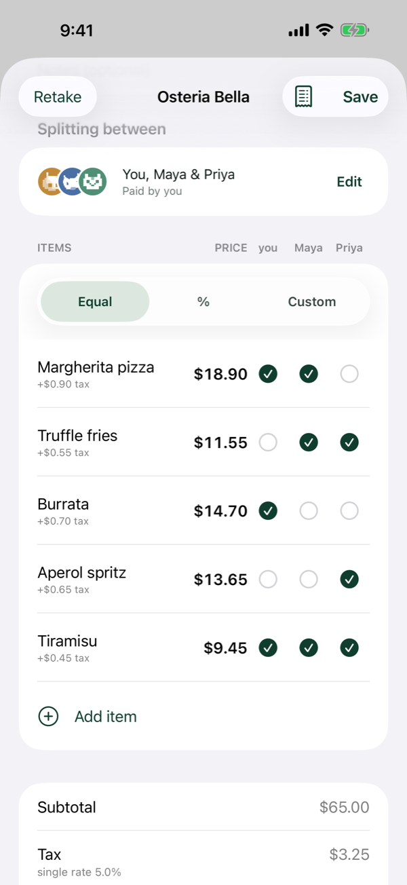
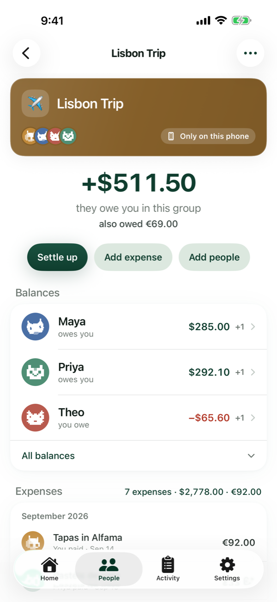

# two cats, under the hood

[two cats](https://twocats.sbarro.dev/) is an iPhone app for splitting shared expenses with the people in your life: the flat, the trip, Friday dinners. This repository holds no code. It is a written tour of how the app is built, for anyone deciding whether it is worth paying for, and for anyone who likes reading about how a small, careful piece of software is put together.

The app itself is closed source. What you will find here is the engineering: the data model, the sync protocol, how money is handled, how a receipt becomes a split, how the design system works, how it is tested, where it runs, and the record of decisions behind all of it.

## What two cats does

You keep the books. Your friends do not need the app, though they can have it. Everything you record is saved on your iPhone first and synced afterwards, so adding an expense never waits for a signal.

- **[Scan a receipt and split it by item.](https://twocats.sbarro.dev/#receipts)** Snap the bill, tap who had what, and the tax follows the items.
- **[Split it the way you agreed.](https://twocats.sbarro.dev/#splits)** Evenly, by percentage, or by exact amounts. The odd cent stays with whoever paid.
- **[Groups for trips, homes and dinner clubs.](https://twocats.sbarro.dev/#groups)** Each group has its own balance, and euros sit next to dollars without being converted.
- **[Rent and bills that repeat.](https://twocats.sbarro.dev/#recurring)** A reminder card on the Home screen before each one is due.
- **[One clear number with each person.](https://twocats.sbarro.dev/#balances)** Every pair of people nets to one balance per currency, and you can settle up with a tap.
- **[A history you can read and undo.](https://twocats.sbarro.dev/#activity)** Every change is logged in plain English and can be reverted from the log.
- **Shared ledgers with other two cats users.** Built and tested, and coming soon.

How to get it, what it costs and the answers to common questions are on [the website](https://twocats.sbarro.dev/#faq), along with the [pricing](https://twocats.sbarro.dev/#pricing), the [privacy policy](https://twocats.sbarro.dev/privacy/) and [support](https://twocats.sbarro.dev/support/).

## The shape of it

<picture>
  <source media="(prefers-color-scheme: dark)" srcset="assets/diagrams/system-overview-dark.svg">
  
</picture>

Six principles shape everything else.

1. **The phone's SQLite database is the source of truth.** Every screen observes it. The server is a synchroniser, not a database the app reads from.
2. **Every write is one transaction.** An expense, its splits, the re-netted balances, the log entry and the sync envelope land together or not at all.
3. **Money is an integer.** Amounts are whole minor units of their own currency, never a floating-point number, and balances are kept per currency and never converted.
4. **Nothing financial is ever deleted.** Rows change state. Voiding is the verb for "stop counting this", and the log remembers.
5. **Derived state can be rebuilt.** Balances come from the expenses and settlements, and the app can replay its own history to check them.
6. **The server never interprets a ledger.** It stores envelopes, checks who may send what to whom, and hands them back in order.

## Read on

| Document | What it covers |
|---|---|
| [Architecture](docs/architecture.md) | The iPhone app's layers, the Go server, the database tables, and four walkthroughs of data moving through them |
| [Money](docs/money.md) | Integer minor units, currencies, the four split modes, pairwise netting, settlement and undo |
| [Receipts](docs/receipts.md) | The camera, cropping, stitching, server-side reading, tax regions, item assignment |
| [Design](docs/design.md) | Liquid Glass policy, the design tokens, the pixel cats, the card stack, motion and 44 pt hit regions |
| [Testing](docs/testing.md) | The four test layers, the hermetic UI-test seam, the hit-region audit, the Postgres integration tests |
| [By the numbers](docs/by-the-numbers.md) | Commits, decisions, tests, lines and builds, measured and dated |

## A few numbers

After about five months of work:

| Measure | As of 2026-10-14 |
|---|---|
| Commits | 1,457 |
| Architecture decision records | 163 |
| Automated tests | about 2,400 across the Swift packages, the app, the UI suite and the Go server |
| Swift and Go, excluding tests | about 71,000 lines |

The full table and how each figure is measured are in [By the numbers](docs/by-the-numbers.md).

## The demo world

The screenshots and the worked examples in these pages share one cast, the same one the website's guides use. You keep the books. Priya, Theo and Maya came to Lisbon; Nora and Jonah share the flat on Maple St; Maya and Dev are at Friday dinners. Each person's cat is generated from their name on every device, with nothing stored or synced, so Priya's cat is Priya's cat on every phone that knows her.

  
  
  
  
  
  

  <picture>
    <source media="(prefers-color-scheme: dark)" srcset="assets/screenshots/dark/01-home.png">
    
  </picture>
  <picture>
    <source media="(prefers-color-scheme: dark)" srcset="assets/screenshots/dark/17-receipt-assign.png">
    
  </picture>
  <picture>
    <source media="(prefers-color-scheme: dark)" srcset="assets/screenshots/dark/15-currency.png">
    
  </picture>

## About this repository

Everything here describes the app as it ships. Where a page states a number, it says when the number was measured. Where it describes something that has not shipped yet, it says so.

The text, diagrams and images are copyright, all rights reserved. See [LICENSE](LICENSE).
