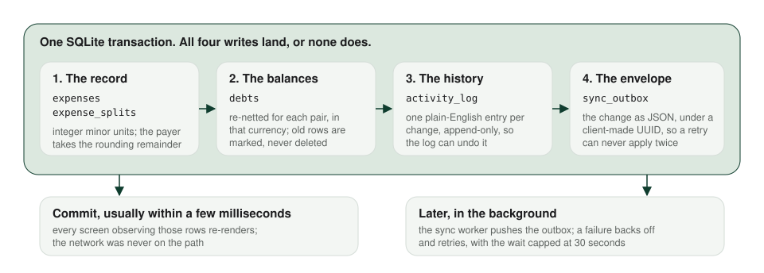

# Architecture

two cats is an iPhone app with a small Go server behind it. The app owns the ledger. The server keeps every device's changes in order, hands them to the devices that may see them, reads receipts on the app's behalf, and backs itself up. This page walks the layers of each side, the tables they share, and four journeys through them. The money rules are in [Money](money.md), and the receipt path in [Receipts](receipts.md).

## The iPhone app

The app is Swift, SwiftUI for every screen, Swift Concurrency for background work, and SQLite through GRDB for storage. GRDB was chosen for one feature above all: its value observation, which re-runs a query and re-renders the screen whenever the rows it read change. There is no cache to invalidate and no "refresh" to remember. A screen declares what it shows, and the database tells it when that changed.

The code is in four layers, and the first three live in two Swift packages that know nothing about screens.

| Layer | What lives there | What it may not do |
|---|---|---|
| Views | SwiftUI screens, the design system, navigation | Hold business logic or write a table |
| Domain | `Expense`, `SplitMode`, `Person`, `Group`, `Settlement`, `RecurringTemplate`; the netting engine, the split allocators, the recurring scheduler, the tax rules, the cat generator | Import GRDB or touch the network |
| Persistence | GRDB record types, repositories behind protocols, the services that run each write as one transaction, migrations | Expose SQL to a view |
| Sync | The outbox drain, the pull, the applier that replays envelopes, the account and invite clients | Change a balance except through the domain engine |

The domain package has no database dependency, so the engine that nets debts or splits a receipt item can be tested as pure functions, in the thousands, in seconds. The persistence package depends on the domain and on GRDB and runs its tests against in-memory SQLite. The app target adds the screens and the glue.

### The local database

Everything the app knows is in one SQLite file on the phone. The tables, in the order a change touches them:

| Table | Holds |
|---|---|
| `people` | Contacts, with an optional link to another two cats account |
| `groups`, `group_memberships` | Trips, flats and dinner clubs, and who is in them |
| `expenses`, `expense_splits` | The original record and each person's share, in integer minor units |
| `expense_items`, `expense_item_assignments` | A scanned receipt's line items and who had each one |
| `debts` | The derived net between each pair of people, per currency |
| `settlements` | Recorded payments |
| `activity_log` | The append-only history every screen's "undo" reads |
| `recurring_templates`, `recurring_instances` | Bills that repeat and each occurrence's state |
| `sync_outbox` | Changes waiting to be pushed |
| `sync_inbound_pending` | Pulled changes waiting for something they depend on |
| `settings` | The owner, the device id, the home currency, the pull cursor |

Every financial row has a state column instead of a delete: an expense is `active` or `voided`, a debt is `open`, `paid` or `auto_settled`, a settlement is `recorded` or `undone`, a recurring template is `active`, `paused` or `ended`. The schema has been migrated 39 times since the first build, every migration additive, and a test upgrades a frozen copy of the version-4 database through all of them and checks that the result matches a fresh one.

## The server

The server is one Go binary: the standard library's HTTP server with the chi router, pgx for Postgres, golang-migrate for the schema, and the S3 SDK for receipt storage. It runs as a single web service on Render, with a cron job beside it for the nightly backup and for one-off operations like a snapshot or a migration.

Its packages map onto what it does: accounts and sessions, invites and links, shared groups, the sync log, receipts, receipt reading, the silent wake that tells other devices to pull, and the small public web surface that serves universal links.

What the server deliberately does not do matters as much as what it does. It never enforces split arithmetic or netting; the phone does that, and the server trusts a well-formed envelope from an account that is allowed to send it. It runs no scheduled jobs for recurring expenses; those post on the phone. It never shows you anything on its own. And it never looks inside a personal envelope's payload: a new kind of change can ship in the app without a server release, because the server stores and forwards JSON it does not parse.

The API is small. Conceptually:

| Route | Does |
|---|---|
| Sign-in routes | A one-time code by SMS, or an anonymous account that can be given a phone number later |
| `POST /sync/push` | Takes a batch of envelopes and answers one ack per envelope |
| `GET /sync/pull?since=` | Returns the envelopes this account may see after a cursor, a page at a time |
| `POST /receipts`, `GET /receipts/{id}` | Stores and serves a receipt photo for the people who may see its expense |
| `POST /ocr/receipt/verbose` | Reads a receipt image and returns the app's receipt JSON |
| Invite, link and shared-group routes | The consent plumbing behind shared ledgers, which are coming soon |
| `POST /devices/push-token` | Registers a device for the silent wake |

Postgres holds the envelope log, accounts, sessions, links, shared groups and invitations. It does not hold a copy of anyone's balances. A new phone rebuilds its ledger by replaying the log.

## Accounts, in concept

You can use two cats with no account at all: type your name and go. The moment you do something that needs the server, such as sharing an invite, the app registers an anonymous account on your behalf and keeps its secret in the iOS Keychain. Adding a phone number later promotes that same account in place, so nothing you had moves. Signing in on a new iPhone is a one-time code by SMS, and the session token lives in the Keychain as a device-only item that never travels in a backup. Sessions slide while they are used, and a device that stopped syncing is flagged to the people linked to it, never acted on.

Signing in on a phone that already has data is its own careful flow: the app stages the session, looks at the account, and asks whether to restore from the cloud or replace the cloud with this phone. It never merges two ledgers silently, and it refuses to replace an account that holds data shared with other people.

## Tech stack

| Layer | Choice | Why |
|---|---|---|
| iOS UI | SwiftUI, iOS 17 and up, Liquid Glass on iOS 26 | Native, and observation-friendly |
| iOS storage | SQLite via GRDB | Observable, transactional, offline-first by nature |
| iOS secrets | Keychain, device-only | The standard for session tokens |
| Receipt reading | Azure Document Intelligence, proxied by the server | Purpose-built receipt model; the key never ships in the app |
| Server language | Go | One small static binary, fast to start, easy to run |
| Server HTTP | `net/http` and chi | A small API surface wants few dependencies |
| Server database | PostgreSQL 18 on PlanetScale | Managed, transactional, with its own backups and point-in-time recovery |
| Receipt photos | Cloudflare R2, private bucket | S3-compatible, no egress fees, never public |
| Off-site backups | Backblaze B2 | Cheap, encrypted before upload |
| Hosting | Render, Oregon | A web service and a cron job, next to the database |
| SMS codes | Twilio Verify | Handles the verification protocol |
| Website | Astro, static output, no client JavaScript by default | Fast, and nothing to track you with |

## Four journeys

### Adding an expense, offline

You tap Add expense, type $30 for dinner, split it equally between Priya, Theo and yourself, and tap Save. One SQLite transaction inserts the expense and three split rows, works out what each pair now owes, re-nets each pair's open debt through the engine, appends a log entry per change, and writes one envelope to the outbox. It commits in a few milliseconds. The Home screen, which observes the debts, redraws its big number. Nothing has touched the network yet. Later, when there is a connection, the sync worker drains the outbox in the background, and you see no change on screen.

<picture>
  <source media="(prefers-color-scheme: dark)" srcset="../assets/diagrams/write-transaction-dark.svg">
  
</picture>

### Settling everyone at once

Home says you owe $73, and you tap Settle all. The app lists one payment per person per currency, $40 to Priya and $33 to Theo, and you confirm. One transaction records the settlements, marks the matching debts paid, writes one grouped log entry with a child per payment, and queues one envelope per payment. The number drops to zero. Before it opened, the sheet pulled once from the server, so a payment a linked friend recorded a minute ago is already reflected and the sheet says so.

### A new iPhone

You install the app and sign in. The app finds no owner on this phone and routes straight to the restore screen, which pulls every page of the account's log from the beginning and replays each envelope into the fresh database through the same code that applies them day to day. Until the pull has reached the head, the app holds settlements and voids, so a half-restored ledger cannot be settled wrong. Once caught up, the phone joins normal sync from its cursor.

### Scanning a receipt

You tap Scan receipt, take one shot with the app's own camera, drag a corner of the detected outline if it missed, and confirm. While the server reads the image, you pick who is splitting. The reviewed receipt then shows each line with a checkbox per person; you tap who had what, the tax spreads itself over the taxed rows, and Save writes an itemized expense, its items, their assignments and every person's share in one transaction. [Receipts](receipts.md) follows this journey end to end.
