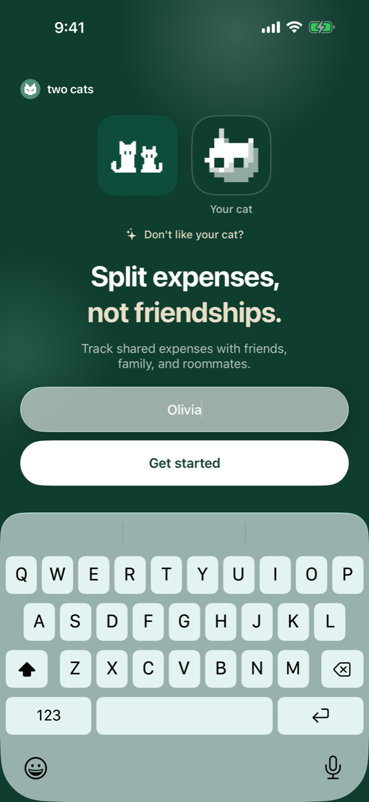
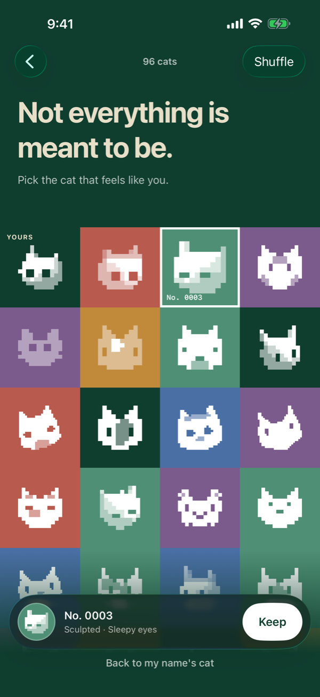
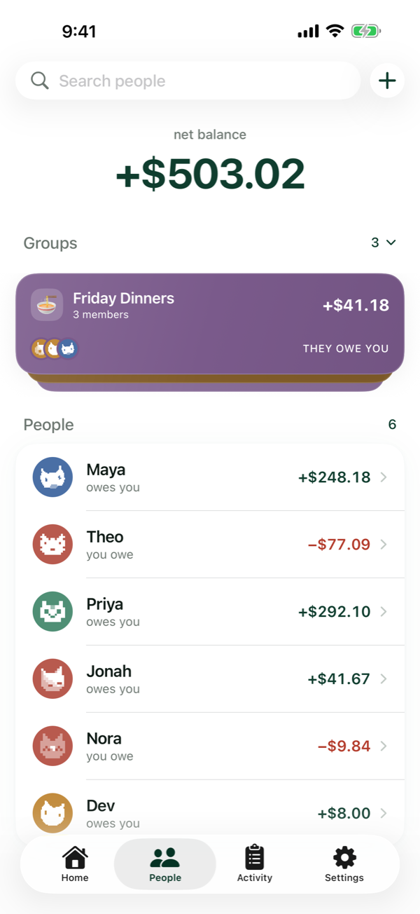

# Design

two cats follows Apple's current iOS design language and adds three things of its own: a small palette, the pixel cats, and a set of rules about motion and touch that are enforced by tests rather than by taste. This page is the design system as it is built.

## The paradigm rule

Every screen is one of two kinds. Creating or editing a financial record, an expense, a receipt, a recurring bill, happens on a plain canvas with rounded cards, the app's own layout, with shared sections for who is splitting, who paid, and the split mode, so Add, Edit and the template editor are the same form. Confirming, settling and settings happen on a standard iOS form, because platform conventions are what people expect at the moment they commit. The Settle screen is the deliberate compromise: a custom amount hero above a standard form.

Glass is chrome only. The tab bar, floating controls and the pills over the card stacks blur what is behind them on iOS 26; content cards and rows never do. Every glass surface in the app goes through one modifier, which is also where Reduce Transparency is honoured, so turning that setting on gives an opaque card with a hairline across the whole app from one place. On iOS 17 and 18 the same modifier picks a material instead.

## Palette and type

The brand colour is a deep forest green, `#0F3D2E`, which becomes mint, `#7EC8A6`, in dark mode. A soft tint, cream for text on forest, and six jewel accents for avatars and groups, forest, sage, slate, plum, terracotta and amber, make up the rest. Terracotta is reserved for "you owe". The jewel colours are the same in both modes; the group cards use darker versions of them so that white text stays readable at every point of a glass highlight, and a test checks the contrast. The [website](https://twocats.sbarro.dev/) uses the same tokens, so the two feel like one thing.

Type is Apple's system font throughout, with tight-tracked bold headlines and tabular figures for every amount. Sizes come from a handful of semantic roles, hero amount, row title, row subtitle, caption, pill label, section header, each scaled with Dynamic Type through a metrics helper and capped where a layout needs it. Spacing is a four-point scale, cards have a 22-point continuous radius, and the hit-region minimum is 44 points.

## The pixel cats

Every person has a cat, drawn from their name. The app's one literal cat is a 10 by 10 pixel sprite used in the wordmark and on first launch; everyone else's is generated. The trimmed display name is hashed with FNV-1a, the hash seeds a SplitMix64 stream, and the stream draws a style, flat, tilted or sculpted, then a head, eyes, mouth, ears, markings and coat. Only integer maths and exactly-reproducible floating-point operations are used, so Priya's cat on your phone is Priya's cat on Theo's, with nothing stored and nothing synced. A thousand random seeds give at least 990 distinct cats, and every one has two eyes.

If you do not like your cat, you can pick another. A chosen cat is a 64-bit seed, which also sets the disc colour, stored on your person row and, once linked, published to friends through the server so they see the one you chose. The picker is a grid of 24 cats a page, generated from a salted stream so that scrolling back shows the same cats, with Shuffle to re-salt and a way back to your name's cat. Generation is fast enough that a page renders in well under 50 milliseconds, and bitmaps are cached by seed.

  <picture>
    <source media="(prefers-color-scheme: dark)" srcset="../assets/screenshots/dark/11-your-cat.png">
    
  </picture>
  <picture>
    <source media="(prefers-color-scheme: dark)" srcset="../assets/screenshots/dark/16-cat-picker.png">
    
  </picture>
  <picture>
    <source media="(prefers-color-scheme: dark)" srcset="../assets/screenshots/dark/02-people.png">
    
  </picture>

The website has a second implementation of the generator, in TypeScript, and the two move in lockstep. The Swift one is the source of truth; a test dumps fixtures from it, and the website's tests fail if any cat differs by a byte. There is no shared source and no code generation, just a line-for-line port and a contract, which is how the site can draw any person's cat without running Swift.

## The card stack

Home's live cards and the Groups stack on People are the same engine with two skins. A collapsed stack shows the front card with the others peeking behind it; a tap expands it into a list; a swipe on a card reveals its actions or clears it. The rule that keeps it smooth is that motion is render-only: per frame, the only things that change are each card's offset and scale, in one transform, and its opacity. The container's height and the header slot are the only animated layout values. No card's frame, padding or spacing is ever animated, there is no blur or offscreen rendering on moving cards, and a card's body is never re-evaluated by a drag.

The swipe is a pure state machine with every constant in one place: a rubber band past the open position, a projection of release velocity over 120 milliseconds, hysteresis around the open fraction so a slow release does not flicker, a flick threshold, and a full-swipe commit that arms at 55% of the width and disarms a little earlier. On iOS 18 and up the gesture is a UIKit pan that refuses to begin on vertical movement, so a vertical drag starting on any card scrolls the list; iOS 17 gets a direction-locked drag with the same feel.

## Motion

Gesture-driven motion uses interpolating springs that carry the release velocity. Everything else uses a named token from one vocabulary, standard, select, present, dismiss, fade, press, value and playful, plus two transitions, and never an inline number. The tokens come in three classes with bounce ceilings: none for layout and programmatic changes, a little for selection and gesture releases, more only for the onboarding brand moments. One state change runs in one animation transaction. Reduce Motion is honoured by every bouncy token, which returns a dissolve, so motion is softened and never cut. The card stack keeps its own springs.

A disclosure inside a list cell animates a clipped height rather than the row's position, so the content above the reveal stays put and the rows below slide. It sounds small; it is the difference between a reveal that feels native and one that jumps.

## Touch

Every interactive element has a hit region of at least 44 by 44 points. The visual may be smaller: the pills over the card stacks are 28 points tall inside a 44-point target, and a glyph-only button is a 32-point glyph in a 44-point target, 48 when it is destructive. A text field's whole row focuses the field, and a toggle's whole row flips it. The one exception is Apple's own navigation-bar items, which keep Apple's 36-point frame, because growing them would grow the iOS 26 glass platters around them.

The rule is enforced by a UI test that walks the main screens, runs Apple's accessibility audit, and then checks every button, field, switch and picker frame against 44 points itself, because Apple's audit passes controls at 36 to 40. Each exception is listed in one file with a reason, and a test checks that every entry has one. [Testing](testing.md) has the rest.

## Accessibility

Amounts are spoken, not spelled: a hero that shows `US$12.40` is read aloud as an amount with its currency named, through a spoken style that every amount label uses, so VoiceOver never reads a symbol. Selection that is only a colour or a ring carries the selected trait. The collapsed card stack is one element that says how many cards it holds, an expanded one is one element per card with its swipe actions as custom actions, and the hidden cards behind a collapsed stack are hidden from VoiceOver too. Onboarding tips render through TipKit, one per session, and the app decides eligibility itself, so a tip never fires for a feature you have already used. Every screen works at the largest accessibility text size, and the screens that changed to scaling fonts had their layouts fixed in the same change.
