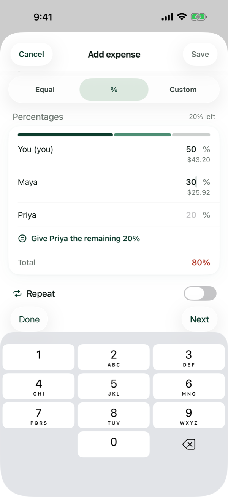
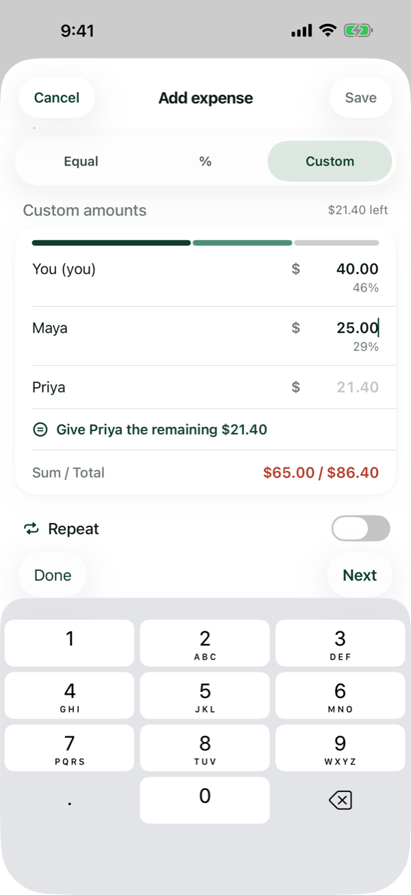
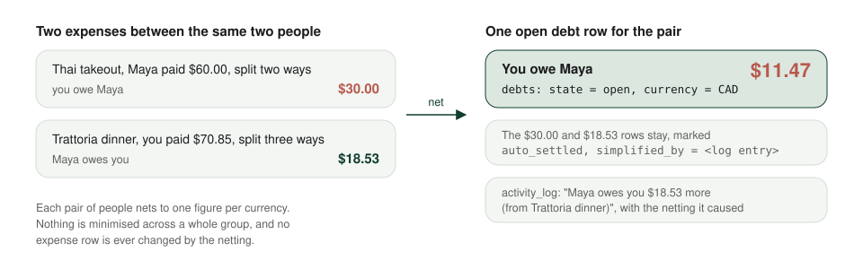
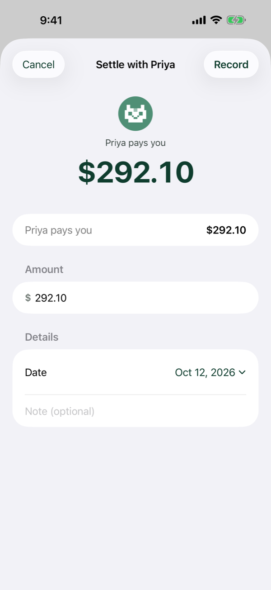
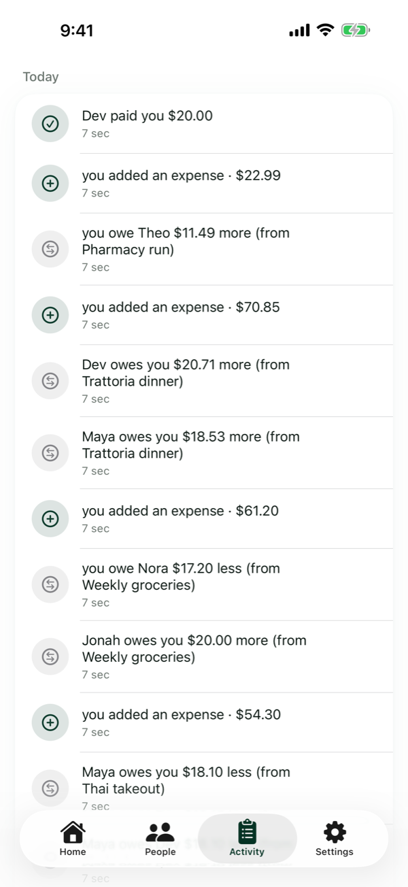

# Money

An expense splitting app has one job it must never get wrong: the arithmetic. This page is how two cats keeps it right. Amounts are integers. Every row says which currency it is in. Splits add up to the exact total, with the odd cent going to whoever paid. Each pair of people nets to one open figure per currency. Nothing financial is deleted, and the balances can be rebuilt from the history at any time.

## An integer, in its own currency

Every amount in the app is a whole number of its currency's minor units: cents for Canadian or US dollars, yen for yen, fils for Bahraini dinars. The type that carries one is a plain integer that cannot be formatted on its own. To show it, a screen has to say which currency it is in and which locale to draw it for, so an amount in French Canadian reads `1,50 $` and the same cents in US English read `$1.50`. There is no path from a float to a stored amount: input is parsed from text into minor units by the currency's number of decimals, and arithmetic runs on integers end to end, on the phone and on the server. Amounts are also capped at input, so a mistyped number cannot overflow a later sum.

Every expense, settlement, debt and recurring template carries one ISO 4217 currency. Its splits, items and instances inherit it. A group can set a default currency for new expenses, and the device has a home currency, by default the one from its locale. The home currency is drawn bare and every other one with a prefixed symbol, so with Canadian dollars at home a US purchase reads `US$12.00` beside `$30.00`.

Balances are kept per currency and never converted, and the app holds no rates at all. A €92.00 dinner in Lisbon sits next to the dollar expenses, the group shows what you are also owed in euros, and you settle the euros in euros. A future "roughly" total with a cached rate would be a display feature; nothing in the ledger would have to change for it.

## The four split modes

An expense is split equally, by percentage, by custom amounts, or by receipt item.

**Equal.** The total is floor-divided by the number of people, and the remainder goes to the payer. On a $100.00 grocery run for the flat, Nora and Jonah each owe $33.33 and your own share, as the payer, is $33.34, so the three shares sum to $100.00 exactly. The payer's share is never zero on an equal split, and no zero row is written for them.

**Percentage.** Each row stores the whole percentage the user typed, as well as the cents it produced. Keeping the percentage matters when the expense is edited: rebuilding 50/25/25 from the cents of a 7-cent total would move money, so an edit reuses the stored percentages when they still reproduce the stored cents and otherwise rebuilds them from the cents, giving the payer the remainder.

**Custom.** Exact amounts per person, which must sum to the total. The editors help without deciding for you: a blank row shows a grey suggestion for the remainder, and nothing is written until you tap it. Switching between percentage and custom carries the typed entries across, flooring on the way to cents and rounding to the nearest whole percent on the way back, capped so the sum never passes 100.

**Itemized.** A scanned receipt. Each item is split among the people who had it, and an item can itself be split by percentage or exact amounts. Each person's share of the expense is the sum of their item shares plus their share of each item's tax. Every item's floor remainder, and the truncation from spreading tax, collects on the payer's row at the expense level, so the shares still sum to the total. [Receipts](receipts.md) has the rest.

  <picture>
    <source media="(prefers-color-scheme: dark)" srcset="../assets/screenshots/dark/12-split-percent.png">
    
  </picture>
  <picture>
    <source media="(prefers-color-scheme: dark)" srcset="../assets/screenshots/dark/13-split-custom.png">
    
  </picture>

## One number per pair

The balance you see with Maya is not a list of expenses. It is one open debt row per ordered pair of people per currency, maintained by a small engine that runs inside every expense and settlement transaction.

<picture>
  <source media="(prefers-color-scheme: dark)" srcset="../assets/diagrams/pairwise-netting-dark.svg">
  
</picture>

When a new debt arrives, the engine looks for the pair's open row. If one exists in the same direction, the new amount accumulates. If one exists in the other direction, the new amount reduces it, cancels it, or flips it, and the row it replaced is marked `auto_settled` with a pointer to the log entry that did it. A settlement marks the row `paid` or reduces it. Voiding an expense runs the same netting in reverse. The engine throws a domain error on bad input, an amount that is not positive, a creditor who is the debtor, or a row in another currency, and nothing in the money path traps.

Netting is pairwise on purpose. The app does not try to minimise the number of payments across a whole group, where Priya paying Theo could cancel a debt you have with each of them. That optimisation makes a balance depend on expenses you were not part of, which is hard to explain and impossible to audit from your own history. One number per pair is something you can check against the list.

The group cards need a figure of their own, and they derive it on read: a group's balance with each person is that group's active expenses with them, minus the settlements attributed to the group. Settlements pay down contexts oldest first, so a payment made after the Lisbon trip clears Lisbon before it touches Friday dinners. The figure is never stored, because the pairwise net is the only stored truth.

## Settling up

A settlement is between two people in one currency. Recording one needs an open debt for the pair in that currency and a positive amount, and the service refuses anything else even if a screen got it wrong. You can pay part of a debt, all of it, or clear everyone at once: Settle all records one settlement per person per currency under one parent log entry, so one tap on Undo reverses the whole batch.

Undo is a state change, not a deletion. The settlement becomes `undone`, the debt is restored through the same engine, and the log gains an entry. Every screen that sums settlements counts `recorded` rows only.

  <picture>
    <source media="(prefers-color-scheme: dark)" srcset="../assets/screenshots/dark/07-settle.png">
    
  </picture>
  <picture>
    <source media="(prefers-color-scheme: dark)" srcset="../assets/screenshots/dark/08-activity.png">
    
  </picture>

## A history you can read and undo

Every change appends to `activity_log`: an expense added, edited or voided, a settlement recorded or undone, a person renamed, a debt netted. The entry stores the names as they were at the time, so a contact deleted later still reads correctly. The log is what the Activity screen shows, in plain English ("Maya owes you $18.53 more (from Trattoria dinner)"), and undoing from the log runs the inverse operation through the same services, which append their own entries. Nothing is rewritten.

Because the balances are derived, the app can check itself. A rebuild replays every active expense's splits and every recorded settlement, in order, through the netting engine into an in-memory ledger, and reports any pair whose stored open debt differs from the replay, with both figures. It is read-only and writes no log entry. In day-to-day use it is a developer tool; its real value is that the invariant it checks is one the design makes true.

## Bills that repeat

A recurring template is an expense with a schedule: every two weeks, monthly on the 1st, yearly. Occurrences are computed from the start date, not from the previous occurrence, so a monthly bill that started on 31 January falls on 28 February and then 31 March. The template stores the time zone of the device that created it, and every device computes the schedule in that zone, so linked phones agree on the day. Each occurrence is an instance that can be posted, skipped or voided; posting one writes a real expense through the ordinary path, with the template's currency and the same split rules. A reminder card on Home says when the next one is coming.

<picture>
  <source media="(prefers-color-scheme: dark)" srcset="../assets/screenshots/dark/09-recurring.png">
  
</picture>
