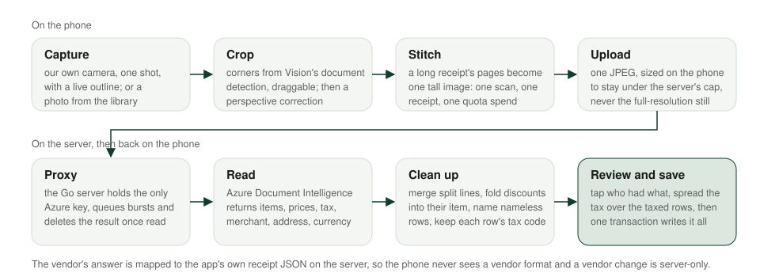
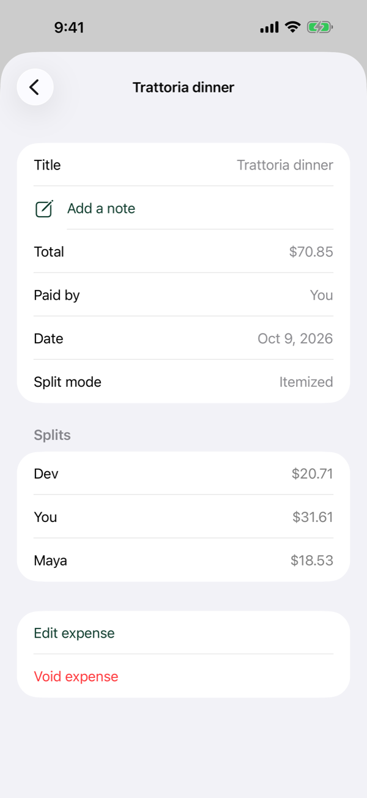

# Receipts

Splitting a restaurant bill by item is the feature people ask for first and the one that is hardest to get right. The receipt is crumpled, the lines are merged or split, the tax is printed once at the bottom, and three people had different things. This page follows a receipt from the camera to a saved expense: capture and crop on the phone, reading on the server, clean-up, review, tax, and the save.

<picture>
  <source media="(prefers-color-scheme: dark)" srcset="../assets/diagrams/receipt-pipeline-dark.svg">
  
</picture>

## Capture

The camera is the app's own, built on AVFoundation rather than the system document scanner. The system scanner is a batch tool that auto-captures and silently drops pages it decides are duplicates, which is the wrong behaviour for a receipt, where every page matters and the user wants one deliberate shot. The app's camera shows a live preview with the detected receipt outlined, running Vision's document detection on the video frames about eight times a second, and takes one still when you press the shutter. Stills are captured at the largest size whose long edge fits 4,096 pixels, so a 48-megapixel sensor does not hand the crop screen a 48-megapixel image. A photo from the library goes through the same next step.

Every shot then opens the crop screen. Its four corners start from Vision's document segmentation on the upright still, fall back to rectangle detection, and fall back again to the whole image. You drag a corner with a loupe placed beside your finger, not under it, and a drag that would fold the quad is refused. Confirm applies a perspective correction, and the corrected image is what the server reads and what is stored as the receipt photo. All of that geometry is pure code with its own tests.

A long receipt is several shots. Add Page keeps the cropped page and returns to the camera, which shows the kept pages as a strip you can delete from. Done stitches the pages top to bottom into one tall image on the phone, scaled to a common width, so a multi-page receipt is still one scan, one receipt and one spend of your scan allowance. The upload is a single JPEG, sized to stay under the server's cap by stepping its quality down only while it is too large, and the app refuses to send an image it already knows the server would reject.

## Reading

The image goes to the Go server, never to a vendor from the phone. The server holds the only key, calls Azure Document Intelligence's receipt model, deletes the result from Azure as soon as it has read it, and maps the answer onto the app's own receipt JSON. Shipped apps decode that JSON and nothing else, so the vendor could change again without an app release; it already changed once, and no app release was needed.

Azure returns line items with names, quantities, unit and total prices, and per-field confidences, plus the merchant, its printed address, the date, the total, the tax lines and the currency. The server's clean-up passes do the things a human does when reading a receipt: a line that wrapped onto two rows is merged, a discount row is folded into the item it discounts, a row with a price and no name gets a guessed one, and the tax code printed after each price is kept as data. Each pass that rewrites a row leaves a note on it, so the review can say "Joined from two receipt lines" instead of just flagging it.

Reading can take a while. The server queues bursts in arrival order rather than failing them, the app waits up to 90 seconds and tells you after 8 that it is still working, and while it waits you pick who is splitting, so the time is not wasted.

## Review

The review screen lists each item with its price and tax and a checkbox per person. Tap who had what; the per-person totals update as you go, and an unassigned item blocks Save. A line Azure was unsure about carries a dashed underline on the doubtful field and a one-line reason, a banner counts the items to check and jumps between them, and "Looks right" clears a row. Nothing about a flag is stored; it is review-time state.

A quantity line, "3 × Aperol spritz", expands into three assignable rows so each can go to a different person. An item shared by two or three people splits equally by default, and the row can open a small bar to split that item by percentage or by exact amounts instead, with at most all but one person pinned and the last share following automatically. A tap on the item opens its sheet, where you can fix the name or price, edit the tax, or see the item on the receipt photo, full screen and zoomable.

  <picture>
    <source media="(prefers-color-scheme: dark)" srcset="../assets/screenshots/dark/17-receipt-assign.png">
    
  </picture>
  <picture>
    <source media="(prefers-color-scheme: dark)" srcset="../assets/screenshots/dark/05-expense-itemized.png">
    
  </picture>

## Tax

Tax on a receipt is printed once, at the bottom, and usually applies to some rows and not others. Each row has a Taxed flag, and the scanned tax is spread across the taxed rows in proportion to their prices, with the floor remainder going to the most expensive taxed row, so the spread sums to the printed tax exactly. Flipping a flag re-spreads it. You can still type a row's tax by hand, and the next flip overwrites that edit.

The flags start smart. When a receipt has tax codes on some rows and not others, and the implied rate on the coded rows is plausible, the coded rows start taxed and the rest untaxed; otherwise every row starts taxed. Where two codes appear, say a province with both a federal and a provincial tax, the app fits the region's candidate rates to the codes against the printed tax and spreads by price times rate, so a row taxed at 5% carries less than one taxed at 12%.

Which region? It is resolved per receipt, in a fixed order: your manual pick, the merchant address printed on the receipt, the country Azure read, the location of a library photo, the phone's location, your setting, and the phone's region. The rate table is data shipped with the app, covering Canada's provinces and territories, every US state, and a set of other countries. Printed tax lines are trusted first, before any table. And the app detects whether prices include tax by checking the receipt's own arithmetic: if the prices sum to the total, the receipt is tax-inclusive, and nothing is spread, so a European receipt is never double-charged.

Location is opt-in and off by default. When it is on, the phone asks for a reduced-accuracy position once, after the reading, and only when the receipt alone did not settle the region. The position is never stored and never sent to the server. Separately, you can choose to keep the merchant's printed address on the expense, per scan, and the detail screen then offers to open it in Maps.

## Save

Save writes an itemized expense in one transaction: the expense, its items, who had each one and their share of it, and every person's share of the whole, with each person paying exactly the tax on their own items. The split for each item runs through one allocator that both the review screen and the save use, so what you were shown is what gets saved. Remainders collect on the payer, as everywhere else in the app, and the shares sum to the total. The receipt photo is uploaded alongside and attached to the expense, where anyone who can see the expense can open it.

If the reading finds no line items at all, a simpler review takes the total and splits it equally between the people you picked. Either way the expense that lands in the ledger is an ordinary expense to the balances, the log and sync, and it carries the receipt's currency, so a Lisbon receipt in euros stays in euros.
